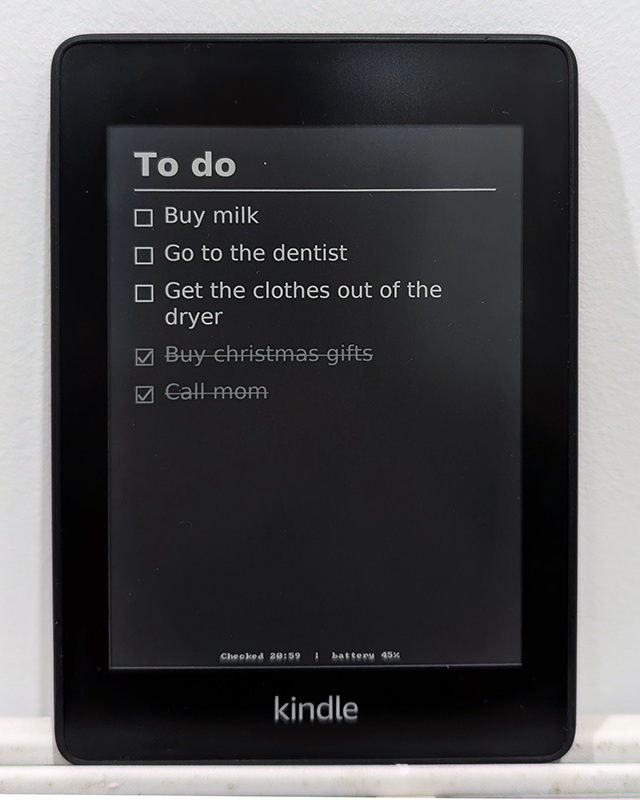
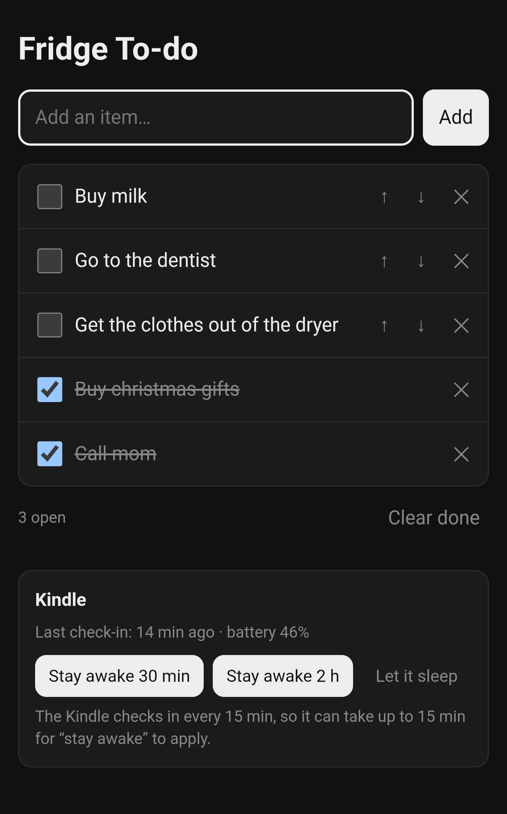
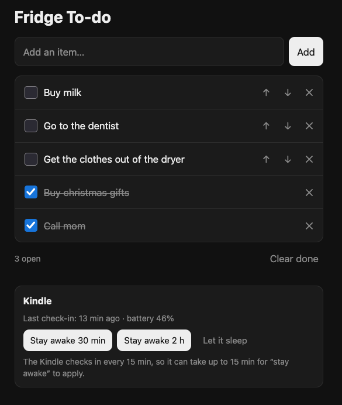

# Kindle Fridge To-do

A personal project: I built this so I can keep an easy-to-update to-do list on my fridge. A jailbroken Kindle hangs on the fridge and shows the list. I edit the list from my phone through a small web app. The Kindle wakes every 15 minutes, downloads the list as a PNG over the LAN, shows it, and suspends again. **With the 15-minute update interval, the battery lasts about 2 weeks.**

It is shared as-is in case it's useful to someone else. It's tuned to my own setup (Kindle 10th gen, Docker host on the LAN), so expect to adapt it.

## Screenshots

| On the Kindle | Web UI (phone) | Web UI (desktop) |
|---|---|---|
|  |  |  |

This README also covers the Kindle's Wi-Fi SSH setup (USBNetLite), which the project depends on.

```
Phone/PC ──https──> your public hostname ──(optional reverse proxy / tunnel)──> Docker host SERVER_IP:8090  [kindle-todo container]
                                                                     ├─ web UI (add / tick / reorder / delete)
                                                                     ├─ SQLite  /opt/kindle-todo/data/todo.db
                                                                     └─ GET /kindle.png  (1072×1448 grayscale, ETag)
Kindle KINDLE_IP ──LAN http──> SERVER_IP:8090/kindle.png
```

Throughout this README, `SERVER_IP` is your Docker host's LAN address and `KINDLE_IP` is the Kindle's Wi-Fi address. Set them in `kindle/fridgetodo/bin/fridge.sh` (`URL`) and the scripts in `scripts/` (or pass `HOST=root@...`).

## Prerequisites

- **A jailbroken Kindle.** This project only works on a jailbroken device, with KUAL installed to launch the extension.
- **USBNetLite installed on the Kindle**, so you can SSH into it (the extension is deployed and controlled over SSH).
- A Linux machine with Docker on the same network, to run the server.

There are plenty of guides online on how to jailbreak a Kindle and install USBNetLite. For legal reasons, I don't provide jailbreak or installation instructions or files here. Jailbreaking is at your own risk and may void your warranty. The Kindle section below only documents the Wi-Fi SSH tweaks I made on top of a working USBNetLite install.

## Repository layout

| Path | What it is |
|---|---|
| `server/app.py` | Flask app: web API, SQLite storage, PNG renderer (Pillow) |
| `server/static/index.html` | Mobile-first web UI (plain HTML + JS, no build step) |
| `server/Dockerfile`, `server/docker-compose.yml` | Container setup (port 8090, data volume `./data`) |
| `server/.env.example` | Template for `.env` (`API_TOKEN`) |
| `kindle/fridgetodo/` | KUAL extension; deployed to `/mnt/us/extensions/fridgetodo` |
| `kindle/fridgetodo/bin/fridge.sh` | The Kindle loop and all control commands |
| `kindle/fridgetodo/menu.json`, `config.xml` | KUAL menu entries |
| `kindle/usbnetlite/` | **Backup copies** of the device's USBNetLite `config` and custom `wifi_ssh_keepalive.sh` (not deployed automatically) |
| `scripts/deploy-server.sh` | Copy `server/` to the Docker host and rebuild the container |
| `scripts/deploy-kindle.sh` | Stop the Kindle loop, copy the extension, restart it (`--no-start` to skip the restart) |
| `scripts/kindle-status.sh` | Retry SSH until the Kindle is awake, then show its status and log |

## Infrastructure

| Thing | Where |
|---|---|
| Kindle | 10th gen, firmware 5.16.8, 1072×1448 8-bit grayscale framebuffer, kernel `4.1.15-lab126` (armv7l). Wi-Fi `KINDLE_IP`, USB `192.168.15.244` (USBNetLite default) |
| Kindle tools used | `eips` (draws the PNG), KOReader's FBInk `/mnt/us/koreader/fbink` (text only, built with `Image=No`), `curl`, `lipc-*`, upstart. No Python. |
| Docker host | Any Linux box with Docker, `root@SERVER_IP`; app in `/opt/kindle-todo` |
| Remote access (optional) | Any reverse proxy or tunnel (I use a Cloudflare tunnel with Access). Not needed for LAN-only use. |

## Server

### Features
- Web UI at `/`:
  - Add, tick off, reorder (↑/↓), and delete items. Double-click an item to edit it. "Clear done" removes all ticked items.
  - New items go to the bottom. Ticked items are greyed out, struck through, and **removed automatically after 24 h**.
  - A Kindle card shows the last check-in time and battery level, and has the **Stay awake 30 min / 2 h / Let it sleep** buttons.
- The PNG renderer picks the largest font size (56→28 px) that fits every item. If items still don't fit, it shows "+ N more…".

### API
| Method | Path | Notes |
|---|---|---|
| GET | `/api/items` | List items (open first, then done) |
| POST | `/api/items` | `{"text": "..."}` |
| PATCH | `/api/items/<id>` | `{"done": true/false}` and/or `{"text": "..."}` |
| DELETE | `/api/items/<id>` | |
| POST | `/api/order` | `{"ids": [3,1,2]}`: new order of the open items |
| POST | `/api/clear-done` | |
| POST | `/api/add` | Same as POST `/api/items` but requires `Authorization: Bearer $API_TOKEN` (or `?token=`). Use it for iOS Shortcuts and Home Assistant. |
| GET | `/api/table` | `{"rows": [["Alice","3","Bob","4"],["Team lunch","Nov 23"]]}`: the notes table drawn at the bottom of the Kindle image |
| PUT | `/api/table` | `{"rows": [[...], ...]}` replaces the table. Rows may have different lengths. Max 12 rows, 8 columns, 60 chars per cell. |
| GET | `/api/kindle` | `last_seen`, `battery`, `stay_awake_until` |
| POST | `/api/kindle/stay-awake` | `{"minutes": 30}`; `0` cancels |
| GET | `/kindle.png?bat=NN` | Records check-in and battery. Supports `If-None-Match` and returns `304` if unchanged. Sends `X-Stay-Awake: <seconds>` while stay-awake is active. |

The token lives in `/opt/kindle-todo/.env` on the Docker host. `deploy-server.sh` generates it on the first deploy.

### Deploy / operate
```sh
./scripts/deploy-server.sh                                    # build + (re)start
ssh root@SERVER_IP 'cd /opt/kindle-todo && docker compose logs -f'
curl -o /tmp/k.png http://SERVER_IP:8090/kindle.png     # preview what the Kindle sees
```
Back up `/opt/kindle-todo/data/todo.db` if the list matters to you.

### Remote access (optional)
The app has no login. If you expose it outside your LAN, put authentication in front of it. For example, with a Cloudflare tunnel:
1. Zero Trust → Networks → Tunnels → your tunnel → Public Hostname: `todo.example.com` → `HTTP` → `SERVER_IP:8090`.
2. Access → Applications → Self-hosted for `todo.example.com`, with an Allow policy for your email only. **The app itself has no login**, so without this the list is public.
3. Optional: add a **Bypass** policy for the path `/api/add` so shortcuts can post items; that endpoint checks the token itself.

Example shortcut call:
```sh
curl -X POST https://todo.example.com/api/add -H "Authorization: Bearer $API_TOKEN" \
     -H 'Content-Type: application/json' -d '{"text":"milk"}'
```

## Kindle extension (`fridge.sh`)

### Commands
Run them over SSH as `sh /mnt/us/extensions/fridgetodo/bin/fridge.sh <cmd>`, or from **KUAL → Fridge To-do**.

| Command | Effect |
|---|---|
| `start` | Start the loop in the background (only one instance runs) |
| `stop` | Kill the loop, turn Wi-Fi on, **bring back the normal Kindle UI** |
| `stop-loop` | Kill the loop only; the screen and UI stay as they are (used by the deploy script) |
| `awake` / `sleep` | Create or remove the `STAY_AWAKE` flag |
| `status` | Running?, flags, autostart, last log lines |
| `autostart-on` / `autostart-off` | Install or remove `/etc/upstart/fridgetodo.conf` (handles `mntroot rw/ro` itself) |
| `run` | The loop itself, run in the foreground (used by `start` and upstart) |

### What one cycle does
1. Turn Wi-Fi on (`lipc-set-prop com.lab126.cmd wirelessEnable 1`) and wait up to 40 s for `cmState=CONNECTED` and an IP address.
2. `curl` the PNG with `If-None-Match`:
   - **200:** save it and do a full-flash redraw with `eips -f -g`.
   - **304:** leave the screen alone.
   - Every 8th wakeup it does a full redraw anyway, to clear ghosting.
3. Draw a footer with FBInk: `Checked HH:MM | battery NN%`, plus `OFFLINE` or `NO WIFI` on errors.
4. If it should stay awake, `sleep 60` and repeat. Otherwise turn Wi-Fi off and **RTC-suspend** for `INTERVAL` (900 s) through `/sys/class/rtc/rtc0/wakealarm` + `echo mem > /sys/power/state`.

When it starts, the loop:
- stops `lab126_gui` and `framework`, so the stock UI doesn't draw over the list
- sets `preventScreenSaver 1`
- turns the frontlight off.

Tunables at the top of `fridge.sh`:
- `URL`
- `INTERVAL` (can be overridden from the environment, e.g. `INTERVAL=60 fridge.sh start` for testing)
- `AWAKE_INTERVAL`
- `FULL_REFRESH_EVERY`
- `RTC_DEV`

### Keeping it awake for SSH
The loop skips Wi-Fi-off and suspend while **any** of these is true:
1. **The web UI's "Stay awake 30 min / 2 h" is active.** The Kindle sees `X-Stay-Awake` at its next check-in, so it can take up to 15 minutes. You don't need to touch the device.
2. **`/mnt/us/fridgetodo/STAY_AWAKE` exists.** Set it with `fridge.sh awake` or KUAL. It's permanent until `fridge.sh sleep`.
3. **An SSH session is open**, i.e. more than one `dropbear` process. Your session won't be cut off.

While awake it refreshes every 60 s.

**Escape hatches:**
- With the USB cable, `ssh root@192.168.15.244` works even while Wi-Fi is off. Give the Mac's RNDIS interface the static IP `192.168.15.1/24`.
- KUAL → Fridge To-do → Stop fridge mode.

Run `./scripts/kindle-status.sh` to keep retrying until the Kindle wakes up, then print its status.

### Autostart
`/etc/upstart/fridgetodo.conf` (created by `autostart-on`) starts the loop **90 s after boot**. That gives you time to SSH in and run `autostart-off`, or `touch /mnt/us/fridgetodo/DISABLE_AUTOSTART`, if something goes wrong. A firmware OTA may remove the file; run `autostart-on` again if so.

### Files on the device
`/mnt/us/fridgetodo/`:
- `fridge.log`: capped at about 2000 lines
- `todo.png`, `etag`, `headers`
- `awake_until`: the server's stay-awake deadline
- `STAY_AWAKE`, `fridge.pid`

### Deploy / develop
```sh
./scripts/deploy-kindle.sh        # stop loop → copy → start
./scripts/kindle-status.sh        # status + last 20 log lines
```
- **Never overwrite `fridge.sh` while the loop is running.** `sh` reads scripts incrementally, so the running loop breaks. The deploy script stops the loop first.
- Edit with LF line endings. If the file ends up with CRLF, run `sed -i 's/\r$//'`.
- Check syntax locally with `sh -n kindle/fridgetodo/bin/fridge.sh`.

### Battery
With the default 15-minute interval (about 20 s awake per cycle), the battery lasts **about 2 weeks** per charge. Check the battery level in the web UI and change `INTERVAL` if needed. Stay-awake mode uses much more power.

## Kindle Wi-Fi SSH (USBNetLite)

### Access
- **SSH:** `ssh root@KINDLE_IP` (Wi-Fi) or `ssh root@192.168.15.244` (USB)
- **Root filesystem:** read-only by default. Run `mntroot rw` to make it writable and `mntroot ro` when done. `/mnt/us` is always writable.

### Key files on the device
| Path | Purpose |
|---|---|
| `/mnt/us/usbnetlite/etc/config` | USBNetLite config (`KINDLE_IP=192.168.15.244`, `PORT="22"`, `USE_WIFI="true"`, password settings). Backup: `kindle/usbnetlite/config` |
| `/mnt/us/usbnetlite/bin/usbnetwork` | Main USBNetLite script, **modified** (see below); original in `usbnetwork.bak` |
| `/mnt/us/usbnetlite/bin/wifi_ssh_keepalive.sh` | **Custom** watcher. Backup: `kindle/usbnetlite/wifi_ssh_keepalive.sh` |
| `/mnt/us/usbnetlite/auto` | Enables USBNet at boot. If this file is missing, nothing starts. |
| `/etc/upstart/usbnetlite.conf` | Upstart job running `usbnetwork` at boot |
| `/mnt/us/usbnetlite/bin/emergency.sh` | If this exists, upstart runs **only** it. It should not exist normally. |

### Problems and fixes
1. **Firewall rule order:** stock `usbnetwork` appended (`-A`) the port-22 ACCEPT rule after the `INPUT` policy `DROP`, so it had no effect. → The watcher inserts it at the top (`-I INPUT 1`).
2. **`wifid` flushes iptables** whenever Wi-Fi sleeps, wakes, or reconnects. → The watcher re-adds the rule every 15 s when it's missing.
3. **Wi-Fi power management** dropped idle SSH sessions. → The watcher runs `iwconfig wlan0 power off`.
4. **The `usb0` IP was the same as the Wi-Fi IP** (`KINDLE_IP` set to the Wi-Fi address). With both interfaces up, especially after a suspend/resume, the `usb0` route won. SSH SYNs arrived over Wi-Fi, but the replies left over USB, so SSH timed out and the loop's fetches failed with `code 000`. → Set `KINDLE_IP=192.168.15.244`. **Never put USB in the Wi-Fi subnet.**

### Watcher script
Every 15 s, if `wlan0` has an IP:
- re-inserts the SSH rule if it's missing
- turns power management off if it's on.

It's single-instance, and it's started from `usbms_to_usbnet()` in `usbnetwork`. The stop in `usbnet_to_usbms()` uses `pkill -f "^/bin/sh .*wifi_ssh_keepalive[.]sh$"`. busybox `killall` can't match script names, because the process name is `sh`.

### Debugging checklist
```sh
ps -ef | grep -c "[0-9] /bin/sh .*keepalive"        # exactly 1 watcher
iptables -L INPUT -n -v --line-numbers | head -5     # dpt:22 rule first; counters show if packets arrive
iwconfig wlan0 | grep -i power                       # Power Management:off
ip route                                              # your LAN subnet and default must be via wlan0, NOT usb0
pidof dropbear
ls -l /mnt/us/usbnetlite/auto /mnt/us/usbnetlite/bin/emergency.sh
```
If the dpt:22 counters go up but SSH still times out, the replies are leaving on the wrong interface; check `ip route`. To fix it live:
```sh
ip addr del KINDLE_IP/24 dev usb0
ip route del default dev usb0; ip route add default via ROUTER_IP dev wlan0
```

### Gotchas
- Don't run an **unanchored** `pkill -f` inside an `ssh host '...'` one-liner. It also matches the remote `sh -c` running your command and kills your session.
- busybox `ps`, `killall` and `pkill` see script processes as `sh`. Use `pgrep -f` with an anchored pattern, or `kill` by PID.
- A shell loop doesn't handle `kill` (SIGTERM) until its current foreground command (e.g. `sleep 60`) finishes. `fridge.sh` uses `sleep & wait`, and `stop` falls back to `kill -9`.
- Firmware OTA updates may overwrite `/etc/upstart/*`. Check `usbnetlite.conf` and `fridgetodo.conf` afterwards.
- `ping -c` needs a count: `ping -c 3 host`.

## Ideas / TODO
- Security: dropbear password login is on by default in the USBNetLite config (`kindle/usbnetlite/config`). Change the password, add your key to `authorized_keys` and set `ALLOW_PASSWORD_LOGIN="false"`.
- Low-battery warning in the web UI or a Home Assistant notification.
